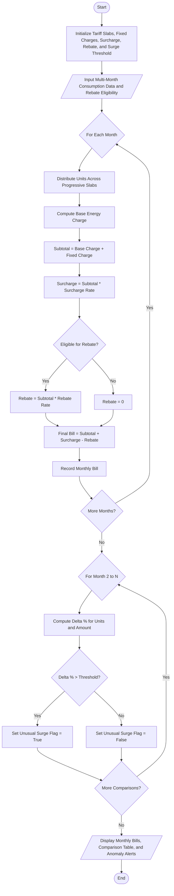

### Problem Statement

Design and implement a program to calculate household monthly electricity bills based on a progressive slab tariff system, including fixed charges, government surcharges, and prompt payment rebates. The program must process consumption across multiple billing cycles (months), generate an itemized bill for each cycle, compute month-over-month percentage changes, and flag any billing cycle where consumption or the final payable amount shows an unusual surge exceeding a specified threshold (e.g., greater than 20% increase compared to the previous month).

---

### Algorithm

1. **Initialize Tariff Parameters:**
* Define consumption tiers/slabs with corresponding per-unit rates.
* Define fixed meter/service charge.
* Define regulatory surcharge percentage.
* Define rebate percentage for eligible timely payments.
* Set anomaly detection surge threshold percentage.


2. **Calculate Energy Charges per Month:**
* For each month's recorded consumption (kWh units):
* Allocate consumed units progressively across defined slabs.
* Multiply units allocated to each slab by the slab rate and sum them to obtain the Base Energy Charge.


3. **Compute Total Monthly Bill:**
* Add the Fixed Charge to the Base Energy Charge to get Subtotal 1.
* Calculate Surcharge as: `Subtotal 1 * (Surcharge Rate / 100)`.
* Calculate Rebate as: `Subtotal 1 * (Rebate Rate / 100)` (if eligible).
* Compute Net Payable as: `Subtotal 1 + Surcharge - Rebate`.


4. **Multi-Month Comparison and Anomaly Flagging:**
* Iterate through the list of monthly bills starting from the second month:
* Compute percentage change in consumption: `((Current Units - Previous Units) / Previous Units) * 100`.
* Compute percentage change in net payable bill: `((Current Bill - Previous Bill) / Previous Bill) * 100`.
* If the percentage increase of consumption or bill exceeds the defined surge threshold, flag the month as an unusual increase.


5. **Display Output:**
* Output individual monthly summaries with itemized charges.
* Output comparative analysis showing month-to-month deltas and anomaly flags.


---

### Flowchart



---

### Python Source Code

```python
class ProgressiveBillingSystem:
    def __init__(self, slabs, fixed_charge, surcharge_pct, rebate_pct, surge_threshold_pct=20.0):
        self.slabs = slabs
        self.fixed_charge = fixed_charge
        self.surcharge_pct = surcharge_pct
        self.rebate_pct = rebate_pct
        self.surge_threshold_pct = surge_threshold_pct

    def compute_energy_charge(self, units):
        remaining_units = units
        total_energy_charge = 0.0
        breakdown = []
        lower_bound = 0

        for slab_limit, rate in self.slabs:
            if remaining_units <= 0:
                break
            slab_capacity = slab_limit - lower_bound
            taxable_in_slab = min(remaining_units, slab_capacity)
            charge = taxable_in_slab * rate
            total_energy_charge += charge
            breakdown.append((f"{lower_bound + 1}-{slab_limit}", taxable_in_slab, rate, charge))
            remaining_units -= taxable_in_slab
            lower_bound = slab_limit

        return total_energy_charge, breakdown

    def generate_monthly_bill(self, month, units, rebate_applied=False):
        energy_charge, breakdown = self.compute_energy_charge(units)
        subtotal = energy_charge + self.fixed_charge
        surcharge = (subtotal * self.surcharge_pct) / 100.0
        rebate = (subtotal * self.rebate_pct) / 100.0 if rebate_applied else 0.0
        final_payable = subtotal + surcharge - rebate

        return {
            "month": month,
            "units": units,
            "energy_charge": round(energy_charge, 2),
            "fixed_charge": round(self.fixed_charge, 2),
            "surcharge": round(surcharge, 2),
            "rebate": round(rebate, 2),
            "final_payable": round(final_payable, 2),
            "breakdown": breakdown
        }

    def analyze_records(self, monthly_records):
        bills = []
        for record in monthly_records:
            bill = self.generate_monthly_bill(
                record["month"], 
                record["units"], 
                record.get("rebate_applied", False)
            )
            bills.append(bill)

        comparison = []
        for i in range(1, len(bills)):
            prev = bills[i - 1]
            curr = bills[i]

            unit_diff = curr["units"] - prev["units"]
            unit_pct = (unit_diff / prev["units"]) * 100.0 if prev["units"] != 0 else 0.0

            bill_diff = curr["final_payable"] - prev["final_payable"]
            bill_pct = (bill_diff / prev["final_payable"]) * 100.0 if prev["final_payable"] != 0 else 0.0

            is_surge = (unit_pct > self.surge_threshold_pct) or (bill_pct > self.surge_threshold_pct)

            comparison.append({
                "from_month": prev["month"],
                "to_month": curr["month"],
                "unit_increase_pct": round(unit_pct, 2),
                "bill_increase_pct": round(bill_pct, 2),
                "unusual_surge": is_surge
            })

        return bills, comparison


if __name__ == "__main__":
    tariff_slabs = [
        (100, 3.00),
        (300, 4.50),
        (500, 6.00),
        (float('inf'), 8.00)
    ]
    fixed_monthly_charge = 50.0
    regulatory_surcharge = 5.0
    prompt_payment_rebate = 2.0
    threshold = 20.0

    billing = ProgressiveBillingSystem(
        slabs=tariff_slabs,
        fixed_charge=fixed_monthly_charge,
        surcharge_pct=regulatory_surcharge,
        rebate_pct=prompt_payment_rebate,
        surge_threshold_pct=threshold
    )

    household_records = [
        {"month": "January", "units": 180, "rebate_applied": True},
        {"month": "February", "units": 195, "rebate_applied": True},
        {"month": "March", "units": 290, "rebate_applied": False},
        {"month": "April", "units": 450, "rebate_applied": True},
        {"month": "May", "units": 440, "rebate_applied": False}
    ]

    bills, comparisons = billing.analyze_records(household_records)

    print("=" * 60)
    print("MONTHLY BILLING SUMMARY")
    print("=" * 60)
    for b in bills:
        print(f"Month: {b['month']}")
        print(f"  Units Consumed : {b['units']} kWh")
        print(f"  Energy Charge  : Rs. {b['energy_charge']:.2f}")
        print(f"  Fixed Charge   : Rs. {b['fixed_charge']:.2f}")
        print(f"  Surcharge (5%) : Rs. {b['surcharge']:.2f}")
        print(f"  Rebate (2%)    : Rs. {b['rebate']:.2f}")
        print(f"  Total Payable  : Rs. {b['final_payable']:.2f}")
        print("-" * 60)

    print("\n" + "=" * 60)
    print("MONTH-OVER-MONTH COMPARISON & SURGE DETECTION")
    print("=" * 60)
    for c in comparisons:
        status = "ALERT: UNUSUAL INCREASE DETECTED" if c["unusual_surge"] else "NORMAL CONSUMPTION"
        print(f"{c['from_month']} -> {c['to_month']}:")
        print(f"  Consumption Delta : {c['unit_increase_pct']:+.2f}%")
        print(f"  Payable Delta     : {c['bill_increase_pct']:+.2f}%")
        print(f"  Status            : {status}")
        print("-" * 60)

```

---

### Sample Input

```python
tariff_slabs = [
    (100, 3.00),
    (300, 4.50),
    (500, 6.00),
    (float('inf'), 8.00)
]
fixed_monthly_charge = 50.0
regulatory_surcharge = 5.0
prompt_payment_rebate = 2.0
surge_threshold = 20.0

household_records = [
    {"month": "January", "units": 180, "rebate_applied": True},
    {"month": "February", "units": 195, "rebate_applied": True},
    {"month": "March", "units": 290, "rebate_applied": False},
    {"month": "April", "units": 450, "rebate_applied": True},
    {"month": "May", "units": 440, "rebate_applied": False}
]

```

---

### Sample Output

```text
============================================================
MONTHLY BILLING SUMMARY
============================================================
Month: January
  Units Consumed : 180 kWh
  Energy Charge  : Rs. 660.00
  Fixed Charge   : Rs. 50.00
  Surcharge (5%) : Rs. 35.50
  Rebate (2%)    : Rs. 14.20
  Total Payable  : Rs. 731.30
------------------------------------------------------------
Month: February
  Units Consumed : 195 kWh
  Energy Charge  : Rs. 727.50
  Fixed Charge   : Rs. 50.00
  Surcharge (5%) : Rs. 38.88
  Rebate (2%)    : Rs. 15.55
  Total Payable  : Rs. 800.82
------------------------------------------------------------
Month: March
  Units Consumed : 290 kWh
  Energy Charge  : Rs. 1155.00
  Fixed Charge   : Rs. 50.00
  Surcharge (5%) : Rs. 60.25
  Rebate (2%)    : Rs. 0.00
  Total Payable  : Rs. 1265.25
------------------------------------------------------------
Month: April
  Units Consumed : 450 kWh
  Energy Charge  : Rs. 2100.00
  Fixed Charge   : Rs. 50.00
  Surcharge (5%) : Rs. 107.50
  Rebate (2%)    : Rs. 43.00
  Total Payable  : Rs. 2164.50
------------------------------------------------------------
Month: May
  Units Consumed : 440 kWh
  Energy Charge  : Rs. 2040.00
  Fixed Charge   : Rs. 50.00
  Surcharge (5%) : Rs. 104.50
  Rebate (2%)    : Rs. 0.00
  Total Payable  : Rs. 2194.50
------------------------------------------------------------

============================================================
MONTH-OVER-MONTH COMPARISON & SURGE DETECTION
============================================================
January -> February:
  Consumption Delta : +8.33%
  Payable Delta     : +9.51%
  Status            : NORMAL CONSUMPTION
------------------------------------------------------------
February -> March:
  Consumption Delta : +48.72%
  Payable Delta     : +58.00%
  Status            : ALERT: UNUSUAL INCREASE DETECTED
------------------------------------------------------------
March -> April:
  Consumption Delta : +55.17%
  Payable Delta     : +71.07%
  Status            : ALERT: UNUSUAL INCREASE DETECTED
------------------------------------------------------------
April -> May:
  Consumption Delta : -2.22%
  Payable Delta     : +1.39%
  Status            : NORMAL CONSUMPTION
------------------------------------------------------------

```
