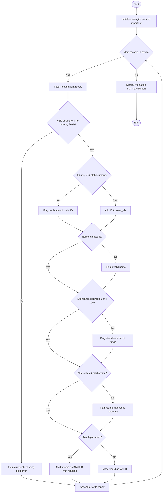

### Problem Statement

Design and develop an **Integrated Student Record Consistency Checker** in Python to audit batch academic data stored using fundamental data structures (tuples and lists). The program validates record integrity by:

1. Detecting missing attributes or `None` values across fields.
2. Validating student identifier format (non-empty alphanumeric string).
3. Ensuring student names contain only alphabetic characters and spaces.
4. Ensuring attendance percentage falls within the range $[0.0, 100.0]$.
5. Verifying that course marks fall within the valid boundary $[0.0, 100.0]$ and that course codes follow non-empty alphanumeric formatting.
6. Identifying duplicate student identifier registrations across records.
7. Flagging inconsistent academic records where the record length is malformed or types deviate from expectations.

---

### Algorithm

1. **Initialize Data Structures:**
* Define a set `seen_ids` to track encountered student IDs and detect duplicates.
* Define a list `validation_report` to accumulate integrity alerts and validation statuses.


2. **Iterate Through Student Records:**
* For each tuple entry in the batch list:
* Check tuple dimensionality and structural integrity (must contain ID, Name, Attendance, Courses list).
* Check for missing/null values across any primary field.
* Validate ID: Non-empty string, alphanumeric, not present in `seen_ids`. Add ID to `seen_ids`.
* Validate Name: Non-empty string consisting only of letters and whitespace.
* Validate Attendance: Numeric value (integer or float) bounded between $0$ and $100$.
* Validate Courses: Non-empty list of `(course_code, mark)` tuples where:
* `course_code` is a valid alphanumeric identifier.
* `mark` is numeric and bounded between $0$ and $100$.


3. **Aggregate and Report:**
* Compile all detected issues per record (Duplicate ID, Format Error, Out-of-Range Value, Missing Field).
* If no errors exist for a record, mark it as `VALID`.
* Output structured diagnostic results.


---

### Flowchart (Mermaid)



---

### Python Source Code

```python
def validate_student_records(records):
    seen_ids = set()
    report = []

    for idx, record in enumerate(records, start=1):
        errors = []

        if not isinstance(record, tuple) or len(record) != 4:
            report.append((idx, "UNKNOWN", False, ["Malformed record structure"]))
            continue

        student_id, name, attendance, courses = record

        if any(v is None for v in (student_id, name, attendance, courses)):
            errors.append("Record contains null/missing fields")

        if not isinstance(student_id, str) or not student_id.isalnum() or len(student_id.strip()) == 0:
            errors.append(f"Invalid student ID format: {student_id}")
        else:
            if student_id in seen_ids:
                errors.append(f"Duplicate student ID detected: {student_id}")
            else:
                seen_ids.add(student_id)

        if not isinstance(name, str) or not name.replace(" ", "").isalpha() or len(name.strip()) == 0:
            errors.append(f"Invalid student name: {name}")

        if not isinstance(attendance, (int, float)) or not (0.0 <= attendance <= 100.0):
            errors.append(f"Attendance out of range [0-100]: {attendance}")

        if not isinstance(courses, list) or len(courses) == 0:
            errors.append("Courses must be a non-empty list of records")
        else:
            for item in courses:
                if not isinstance(item, tuple) or len(item) != 2:
                    errors.append(f"Invalid course entry format: {item}")
                    continue
                code, mark = item
                if not isinstance(code, str) or not code.isalnum():
                    errors.append(f"Invalid course code: {code}")
                if not isinstance(mark, (int, float)) or not (0.0 <= mark <= 100.0):
                    errors.append(f"Mark out of range [0-100] in {code}: {mark}")

        status = len(errors) == 0
        sid_label = student_id if isinstance(student_id, str) and student_id else f"INDEX_{idx}"
        report.append((idx, sid_label, status, errors))

    return report


def display_report(report):
    print("=" * 80)
    print(f"{'REC #':<7}{'STUDENT ID':<15}{'STATUS':<12}{'ANOMALIES / REMARKS'}")
    print("=" * 80)
    for rec_num, sid, status, issues in report:
        stat_str = "VALID" if status else "INVALID"
        if status:
            print(f"{rec_num:<7}{sid:<15}{stat_str:<12}No inconsistencies detected")
        else:
            first = True
            for err in issues:
                if first:
                    print(f"{rec_num:<7}{sid:<15}{stat_str:<12}{err}")
                    first = False
                else:
                    print(f"{'':<7}{'':<15}{'':<12}{err}")
    print("=" * 80)


if __name__ == "__main__":
    dataset = [
        ("S101", "Alice Smith", 94.5, [("CS101", 88.0), ("MA101", 91.5)]),
        ("S102", "Bob 123", 82.0, [("CS101", 72.0)]),
        ("S103", "Charlie Brown", 105.0, [("CS101", -5.0), ("PH101", 80.0)]),
        ("S101", "Alice Duplicate", 90.0, [("CS101", 85.0)]),
        ("S104", "David Miller", None, [("CS101", 65.0)]),
        ("S105", "Eve Adams", 89.0, []),
        ("S106", "Frank Wright", 76.0, [("CS#99", 55.0), ("MA101", 120.0)]),
        ("S107", "Grace Hopper", 98.0, [("CS101", 99.0), ("MA101", 100.0)]),
    ]

    results = validate_student_records(dataset)
    display_report(results)

```

---

### Sample Input

```python
[
    ("S101", "Alice Smith", 94.5, [("CS101", 88.0), ("MA101", 91.5)]),
    ("S102", "Bob 123", 82.0, [("CS101", 72.0)]),
    ("S103", "Charlie Brown", 105.0, [("CS101", -5.0), ("PH101", 80.0)]),
    ("S101", "Alice Duplicate", 90.0, [("CS101", 85.0)]),
    ("S104", "David Miller", None, [("CS101", 65.0)]),
    ("S105", "Eve Adams", 89.0, []),
    ("S106", "Frank Wright", 76.0, [("CS#99", 55.0), ("MA101", 120.0)]),
    ("S107", "Grace Hopper", 98.0, [("CS101", 99.0), ("MA101", 100.0)]),
]

```

---

### Sample Output

```text
================================================================================
REC #  STUDENT ID     STATUS      ANOMALIES / REMARKS
================================================================================
1      S101           VALID       No inconsistencies detected
2      S102           INVALID     Invalid student name: Bob 123
3      S103           INVALID     Attendance out of range [0-100]: 105.0
                                  Mark out of range [0-100] in CS101: -5.0
4      S101           INVALID     Duplicate student ID detected: S101
5      S104           INVALID     Record contains null/missing fields
                                  Attendance out of range [0-100]: None
6      S105           INVALID     Courses must be a non-empty list of records
7      S106           INVALID     Invalid course code: CS#99
                                  Mark out of range [0-100] in MA101: 120.0
8      S107           VALID       No inconsistencies detected
================================================================================

```
