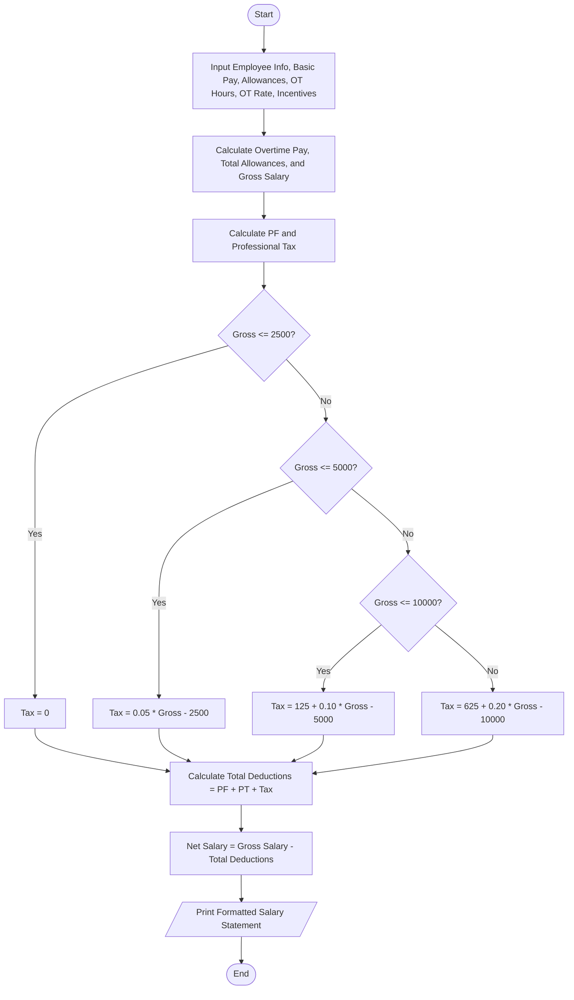

### Problem Statement

Design and implement a payroll processing system to compute an employee's gross salary, total progressive deductions, and final net pay, producing an itemized salary statement.

Gross salary is calculated from basic pay, allowances (Dearness Allowance, House Rent Allowance, Conveyance, and Medical), overtime compensation, and incentives. Total deductions consist of standard fixed contributions (Provident Fund and Professional Tax) along with income tax calculated using progressive tax brackets based on taxable gross earnings.

---

### Algorithm

1. Input employee details: ID, Name, Basic Pay, Allowances (HRA, DA, Conveyance, Medical), Overtime Hours, Overtime Hourly Rate, and Performance Incentives.
2. Calculate Overtime Pay: $\text{Overtime Pay} = \text{Overtime Hours} \times \text{Overtime Rate}$.
3. Calculate Total Allowances: $\text{Allowances} = \text{HRA} + \text{DA} + \text{Conveyance} + \text{Medical}$.
4. Compute Gross Salary: $\text{Gross Salary} = \text{Basic Pay} + \text{Allowances} + \text{Overtime Pay} + \text{Incentives}$.
5. Calculate Statutory Deductions:
* $\text{Provident Fund (PF)} = 0.12 \times \text{Basic Pay}$
* $\text{Professional Tax (PT)} = 200.00$


6. Calculate Progressive Income Tax:
* For earnings up to $2,500: 0%
* For earnings between $2,501 and $5,000: 5% on the amount over $2,500
* For earnings between $5,001 and $10,000: $125 + 10% on the amount over $5,000
* For earnings exceeding $10,000: $625 + 20% on the amount over $10,000


7. Compute Total Deductions: $\text{Total Deductions} = \text{PF} + \text{PT} + \text{Income Tax}$.
8. Compute Net Salary: $\text{Net Salary} = \text{Gross Salary} - \text{Total Deductions}$.
9. Display the formatted employee salary statement.

---

### Flowchart (Mermaid)



---

### Python Source Code

```python
def calculate_income_tax(gross_salary):
    tax = 0.0
    if gross_salary <= 2500:
        tax = 0.0
    elif gross_salary <= 5000:
        tax = (gross_salary - 2500) * 0.05
    elif gross_salary <= 10000:
        tax = 125.0 + (gross_salary - 5000) * 0.10
    else:
        tax = 625.0 + (gross_salary - 10000) * 0.20
    return tax

def generate_payroll():
    emp_id = input()
    emp_name = input()
    basic_pay = float(input())
    hra = float(input())
    da = float(input())
    conveyance = float(input())
    medical = float(input())
    ot_hours = float(input())
    ot_rate = float(input())
    incentives = float(input())

    ot_pay = ot_hours * ot_rate
    total_allowances = hra + da + conveyance + medical
    gross_salary = basic_pay + total_allowances + ot_pay + incentives

    pf = basic_pay * 0.12
    pt = 200.00
    income_tax = calculate_income_tax(gross_salary)
    total_deductions = pf + pt + income_tax

    net_salary = gross_salary - total_deductions

    print("=" * 60)
    print(f"{'EMPLOYEE SALARY STATEMENT':^60}")
    print("=" * 60)
    print(f"Employee ID   : {emp_id:<20} Employee Name : {emp_name}")
    print("-" * 60)
    print(f"{'EARNINGS':<30}{'AMOUNT':>10} | {'DEDUCTIONS':<20}{'AMOUNT':>8}")
    print("-" * 60)
    print(f"{'Basic Pay':<30}{basic_pay:>10.2f} | {'Provident Fund':<20}{pf:>8.2f}")
    print(f"{'HRA':<30}{hra:>10.2f} | {'Prof. Tax':<20}{pt:>8.2f}")
    print(f"{'DA':<30}{da:>10.2f} | {'Income Tax':<20}{income_tax:>8.2f}")
    print(f"{'Conveyance Allowance':<30}{conveyance:>10.2f} | {'':<20}{'':>8}")
    print(f"{'Medical Allowance':<30}{medical:>10.2f} | {'':<20}{'':>8}")
    print(f"{'Overtime Pay':<30}{ot_pay:>10.2f} | {'':<20}{'':>8}")
    print(f"{'Performance Incentives':<30}{incentives:>10.2f} | {'':<20}{'':>8}")
    print("-" * 60)
    print(f"{'Gross Earnings':<30}{gross_salary:>10.2f} | {'Total Deductions':<20}{total_deductions:>8.2f}")
    print("=" * 60)
    print(f"{'NET PAYABLE':<42} : ${net_salary:>14.2f}")
    print("=" * 60)

if __name__ == "__main__":
    generate_payroll()

```

---

### Sample Input

```text
EMP-1042
Sarah Jenkins
6500.00
1200.00
650.00
300.00
250.00
15
40.00
750.00

```

---

### Sample Output

```text
============================================================
                 EMPLOYEE SALARY STATEMENT                  
============================================================
Employee ID   : EMP-1042             Employee Name : Sarah Jenkins
------------------------------------------------------------
EARNINGS                          AMOUNT | DEDUCTIONS             AMOUNT
------------------------------------------------------------
Basic Pay                        6500.00 | Provident Fund         780.00
HRA                              1200.00 | Prof. Tax              200.00
DA                                650.00 | Income Tax             665.00
Conveyance Allowance              300.00 |                              
Medical Allowance                 250.00 |                              
Overtime Pay                      600.00 |                              
Performance Incentives            750.00 |                              
------------------------------------------------------------
Gross Earnings                  10250.00 | Total Deductions      1645.00
============================================================
NET PAYABLE                                : $       8605.00
============================================================

```
