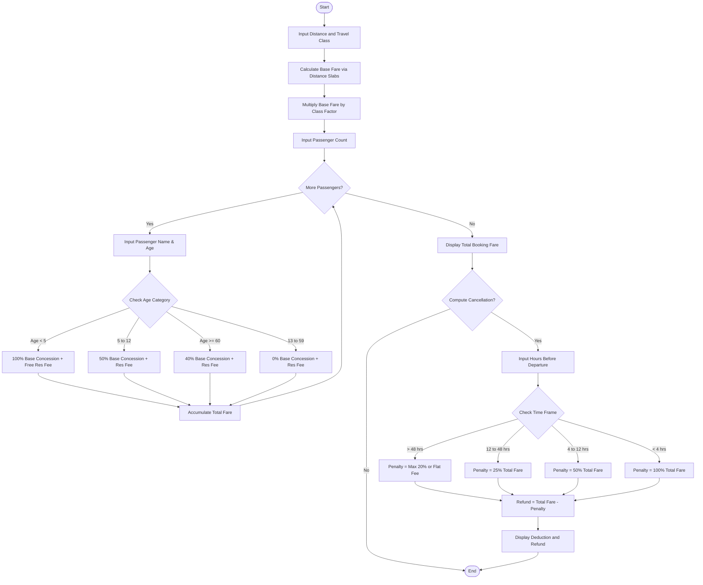

### Problem Statement

Design and implement a Railway Fare and Reservation Calculator in Python capable of computing the net payable ticket fare for single or multiple passengers, as well as calculating refundable amounts and deduction charges upon cancellation.

The system must satisfy the following rules:

1. **Distance-Based Base Fare (Slabs):**
* 1 to 100 km: Flat base fare of $50
* 101 to 500 km: $50 + $0.80 per km above 100 km
* 501 to 1000 km: $370 + $0.60 per km above 500 km
* Above 1000 km: $670 + $0.40 per km above 1000 km


2. **Travel Class Multipliers:**
* General (GEN): $1.0\times$
* Sleeper (SL): $1.2\times$
* AC 3-Tier (3A): $1.8\times$
* AC 2-Tier (2A): $2.5\times$
* AC First Class (1A): $3.5\times$


3. **Fixed Reservation Fees (Per Passenger):**
* GEN: $15
* SL: $20
* 3A: $40
* 2A: $50
* 1A: $60


4. **Age-Based Concessions (Applied to Base Fare Only):**
* Child (Age < 5): 100% concession (Base fare = $0; reservation fee waived)
* Child (Age 5–12): 50% concession on base fare
* Senior Citizen (Age >= 60): 40% concession on base fare
* Standard Passenger (Age 13–59): 0% concession


5. **Cancellation Deductions (Per Passenger):**
* More than 48 hours before departure: 20% of total ticket fare or flat cancellation fee ($30), whichever is higher.
* 12 to 48 hours before departure: 25% of total ticket fare.
* 4 to 12 hours before departure: 50% of total ticket fare.
* Less than 4 hours before departure: No refund (100% deduction).


---

### Algorithm

1. Define distance slab boundaries, class multipliers, class reservation fees, and cancellation penalty brackets.
2. Read the total journey distance ($D$) and travel class ($C$).
3. Compute the unadjusted base fare based on the distance slab rules:
* If $D \le 100$: $\text{Fare} = 50$
* Else if $D \le 500$: $\text{Fare} = 50 + (D - 100) \times 0.80$
* Else if $D \le 1000$: $\text{Fare} = 370 + (D - 500) \times 0.60$
* Else: $\text{Fare} = 670 + (D - 1000) \times 0.40$


4. Multiply unadjusted base fare by the travel class multiplier to obtain the standard class base fare.
5. Initialize total booking cost to 0.
6. For each passenger:
* Read name and age.
* Determine concession percentage based on age:
* Age < 5: 100% discount on base fare, reservation fee = 0.
* 5 $\le$ Age $\le$ 12: 50% discount on base fare, standard reservation fee.
* Age $\ge$ 60: 40% discount on base fare, standard reservation fee.
* 13 $\le$ Age $\le$ 59: 0% discount on base fare, standard reservation fee.


* $\text{Passenger Fare} = (\text{Class Base Fare} \times (1 - \text{Discount Rate})) + \text{Reservation Fee}$.
* Add Passenger Fare to total booking cost.


7. Prompt whether a cancellation calculation is needed:
* If yes, input the cancellation time relative to departure (in hours).
* Compute penalty based on the time window:
* $> 48\text{ hrs}$: $\max(0.20 \times \text{Total Fare}, 30 \times \text{Passenger Count})$
* $12 \text{ to } 48\text{ hrs}$: $0.25 \times \text{Total Fare}$
* $4 \text{ to } 12\text{ hrs}$: $0.50 \times \text{Total Fare}$
* $< 4\text{ hrs}$: $1.00 \times \text{Total Fare}$


* Compute $\text{Refund} = \max(0, \text{Total Fare} - \text{Penalty})$.


8. Output the itemized breakdown, total booking fare, penalty deduction, and refund amount.

---

### Flowchart



---

### Python Source Code

```python
def get_base_fare(distance):
    if distance <= 100:
        return 50.0
    elif distance <= 500:
        return 50.0 + (distance - 100) * 0.80
    elif distance <= 1000:
        return 370.0 + (distance - 500) * 0.60
    else:
        return 670.0 + (distance - 1000) * 0.40

def calculate_passenger_fare(class_base_fare, res_fee, age):
    if age < 5:
        return 0.0, 0.0, "Infant (100% Off, No Fee)"
    elif age <= 12:
        fare = (class_base_fare * 0.50) + res_fee
        return fare, res_fee, "Child (50% Off)"
    elif age >= 60:
        fare = (class_base_fare * 0.60) + res_fee
        return fare, res_fee, "Senior (40% Off)"
    else:
        fare = class_base_fare + res_fee
        return fare, res_fee, "General (Full)"

def compute_cancellation(total_fare, num_passengers, hours):
    if hours > 48:
        flat_deduction = 30.0 * num_passengers
        percentage_deduction = 0.20 * total_fare
        penalty = max(flat_deduction, percentage_deduction)
    elif hours >= 12:
        penalty = 0.25 * total_fare
    elif hours >= 4:
        penalty = 0.50 * total_fare
    else:
        penalty = total_fare
    
    penalty = min(penalty, total_fare)
    refund = total_fare - penalty
    return penalty, refund

def main():
    class_multipliers = {"GEN": 1.0, "SL": 1.2, "3A": 1.8, "2A": 2.5, "1A": 3.5}
    reservation_fees = {"GEN": 15.0, "SL": 20.0, "3A": 40.0, "2A": 50.0, "1A": 60.0}

    distance = float(input().strip())
    travel_class = input().strip().upper()

    if travel_class not in class_multipliers:
        return

    base_dist_fare = get_base_fare(distance)
    class_base_fare = base_dist_fare * class_multipliers[travel_class]
    res_fee = reservation_fees[travel_class]

    num_passengers = int(input().strip())
    passengers = []
    total_fare = 0.0

    for _ in range(num_passengers):
        line = input().strip().split(",")
        name = line[0].strip()
        age = int(line[1].strip())
        fare, fee_applied, category = calculate_passenger_fare(class_base_fare, res_fee, age)
        total_fare += fare
        passengers.append((name, age, category, fare))

    is_cancellation = input().strip().lower()
    cancel_hours = None
    if is_cancellation in ("yes", "y"):
        cancel_hours = float(input().strip())

    print(f"Journey Distance: {distance:.2f} km")
    print(f"Travel Class: {travel_class}")
    print(f"Class Base Fare: ${class_base_fare:.2f}")
    print(f"Reservation Fee: ${res_fee:.2f}")
    print("--------------------------------------------------")
    for name, age, cat, fare in passengers:
        print(f"Passenger: {name:15} | Age: {age:2} | Category: {cat:22} | Fare: ${fare:.2f}")
    print("--------------------------------------------------")
    print(f"Total Booking Amount: ${total_fare:.2f}")

    if cancel_hours is not None:
        penalty, refund = compute_cancellation(total_fare, num_passengers, cancel_hours)
        print("--------------------------------------------------")
        print(f"Cancellation Time: {cancel_hours:.1f} hours before departure")
        print(f"Cancellation Charges: ${penalty:.2f}")
        print(f"Net Refund Amount: ${refund:.2f}")

if __name__ == "__main__":
    main()

```

---

### Sample Input

```text
750
3A
3
Alice Johnson, 34
Bob Johnson, 68
Charlie Johnson, 8
yes
36

```

---

### Sample Output

```text
Journey Distance: 750.00 km
Travel Class: 3A
Class Base Fare: $936.00
Reservation Fee: $40.00
--------------------------------------------------
Passenger: Alice Johnson   | Age: 34 | Category: General (Full)        | Fare: $976.00
Passenger: Bob Johnson     | Age: 68 | Category: Senior (40% Off)      | Fare: $601.60
Passenger: Charlie Johnson | Age:  8 | Category: Child (50% Off)       | Fare: $508.00
--------------------------------------------------
Total Booking Amount: $2085.60
--------------------------------------------------
Cancellation Time: 36.0 hours before departure
Cancellation Charges: $521.40
Net Refund Amount: $1564.20

```
