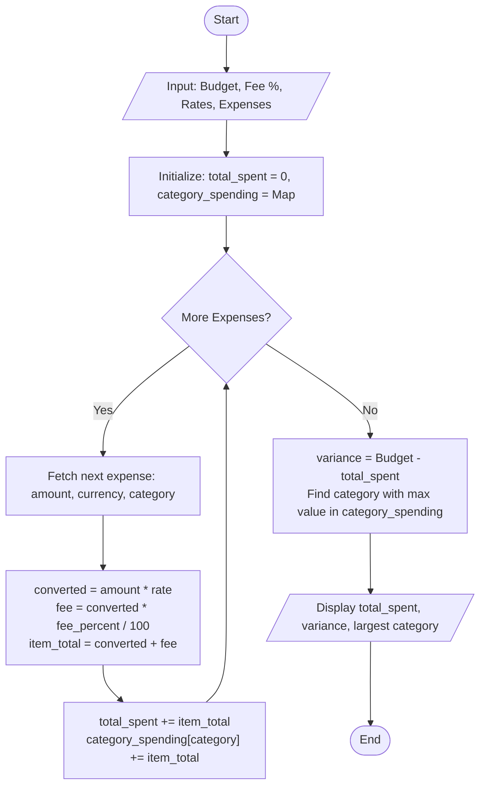

### Problem Statement

Travelers frequently incur expenses across multiple foreign currencies while managing a fixed budget defined in their base currency. Each foreign transaction incurs a dynamic conversion fee based on the converted value.

Develop a program that:

1. Accepts a total budget in a base currency.
2. Accepts a set of exchange rates relative to the base currency.
3. Ingests a list of expenses, each specifying an amount, foreign currency, and category.
4. Converts each foreign expense to the base currency and applies a percentage-based conversion fee.
5. Computes total spending and compares it against the allocated budget to identify remaining funds or budget overruns.
6. Identifies the expense category with the highest cumulative spending in the base currency.

---

### Algorithm

1. Initialize `total_spent = 0` and an empty hash map `category_spending`.
2. Input `base_budget`, `fee_percentage`, exchange rate dictionary `rates`, and expense transaction records.
3. For each expense record `(amount, currency, category)`:
a. Retrieve the exchange rate for `currency` relative to the base currency.
b. Calculate base value: `converted_amount = amount * exchange_rate`.
c. Calculate transaction fee: `fee = converted_amount * (fee_percentage / 100)`.
d. Compute total item cost: `final_item_cost = converted_amount + fee`.
e. Add `final_item_cost` to `total_spent`.
f. If `category` exists in `category_spending`, add `final_item_cost` to it; otherwise, initialize it with `final_item_cost`.
4. Calculate budget variance: `variance = base_budget - total_spent`.
5. Identify the largest category by selecting the key in `category_spending` with the maximum value.
6. Output total converted expenditure, remaining balance or overrun, and the largest spending category with its respective total.

---

### Flowchart



---

### Python Source Code

```python
def analyze_budget(budget, fee_percent, exchange_rates, expenses):
    total_spent = 0.0
    category_spending = {}

    for amount, currency, category in expenses:
        rate = exchange_rates.get(currency, 1.0)
        converted = amount * rate
        fee = converted * (fee_percent / 100.0)
        final_cost = converted + fee
        
        total_spent += final_cost
        category_spending[category] = category_spending.get(category, 0.0) + final_cost

    remaining = budget - total_spent
    largest_category = max(category_spending, key=category_spending.get)
    largest_amount = category_spending[largest_category]

    print(f"Total Budget: {budget:.2f}")
    print(f"Total Spent: {total_spent:.2f}")
    if remaining >= 0:
        print(f"Remaining Budget: {remaining:.2f}")
    else:
        print(f"Budget Exceeded By: {abs(remaining):.2f}")
    print(f"Largest Category: {largest_category} ({largest_amount:.2f})")


budget = 2500.00
fee_percentage = 2.0
rates = {
    "USD": 1.0,
    "EUR": 1.08,
    "JPY": 0.0067,
    "GBP": 1.27
}
expenses = [
    (120.0, "EUR", "Lodging"),
    (45.0, "GBP", "Food"),
    (15000.0, "JPY", "Transport"),
    (300.0, "EUR", "Lodging"),
    (80.0, "USD", "Activities")
]

analyze_budget(budget, fee_percentage, rates, expenses)

```

---

### Sample Input

```text
Budget: 2500.00 USD
Fee Percentage: 2.0%

Exchange Rates (to USD):
EUR: 1.08
GBP: 1.27
JPY: 0.0067
USD: 1.00

Expenses:
- Amount: 120.0,  Currency: EUR, Category: Lodging
- Amount: 45.0,   Currency: GBP, Category: Food
- Amount: 15000.0, Currency: JPY, Category: Transport
- Amount: 300.0,  Currency: EUR, Category: Lodging
- Amount: 80.0,   Currency: USD, Category: Activities

```

---

### Sample Output

```text
Total Budget: 2500.00
Total Spent: 769.76
Remaining Budget: 1730.24
Largest Category: Lodging (462.67)

```
