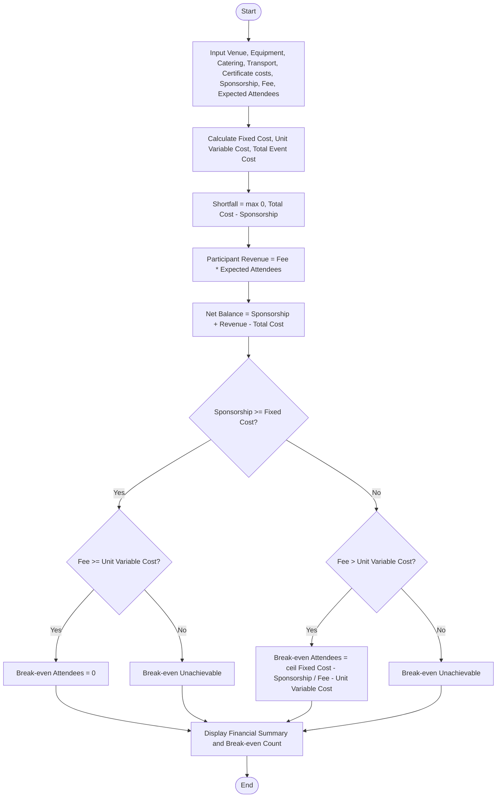

### Problem Statement

Design and implement a financial planning program for a campus event. The program calculates the total event expenditure based on fixed costs (venue and equipment) and variable costs (catering, participant certificates, and transportation). Given anticipated sponsorship amounts, attendee registration fees, and estimated participant turnout, the system computes:

1. Total event expenditure.
2. Net deficit or sponsorship shortfall before participant collections.
3. Total revenue generated from participant contributions.
4. Final surplus or deficit balance.
5. Minimum number of participant registrations required to achieve break-even.

---

### Algorithm

1. **Start**
2. **Input:**
* Fixed costs: Venue cost ($C_v$), Equipment cost ($C_e$).
* Variable costs per attendee: Catering cost ($c_c$), Certificate cost ($c_k$), Transport cost ($c_t$).
* Event parameters: Total confirmed sponsorship ($S$), Registration fee per attendee ($R$), Expected attendee count ($N$).


3. **Compute Total Fixed Cost:**

$$\text{Fixed Cost} = C_v + C_e$$


4. **Compute Total Variable Cost per Attendee:**

$$\text{Unit Variable Cost} = c_c + c_k + c_t$$


5. **Compute Total Budget:**

$$\text{Total Cost} = \text{Fixed Cost} + (\text{Unit Variable Cost} \times N)$$


6. **Compute Sponsorship Shortfall:**

$$\text{Shortfall} = \max(0, \text{Total Cost} - S)$$


7. **Compute Participant Contribution:**

$$\text{Participant Revenue} = R \times N$$


8. **Compute Net Financial Balance:**

$$\text{Net Balance} = (S + \text{Participant Revenue}) - \text{Total Cost}$$


9. **Compute Break-Even Attendees ($N_{be}$):**
* If $S \ge \text{Fixed Cost}$:
* If $R \ge \text{Unit Variable Cost}$, $N_{be} = 0$.
* Else, break-even is not achievable as variable cost exceeds revenue per attendee.


* If $S < \text{Fixed Cost}$:
* Remaining fixed burden = $\text{Fixed Cost} - S$.
* Contribution margin per attendee = $R - \text{Unit Variable Cost}$.
* If contribution margin $\le 0$, break-even is impossible.
* Else, $N_{be} = \lceil (\text{Fixed Cost} - S) / (R - \text{Unit Variable Cost}) \rceil$.


10. **Display:** Total cost, sponsorship shortfall, participant revenue, net balance, and break-even participant count.
11. **Stop**

---

### Flowchart



---

### Python Source Code

```python
import math

def calculate_event_finances():
    venue_cost = float(input())
    equipment_cost = float(input())
    catering_per_person = float(input())
    transport_per_person = float(input())
    certificate_per_person = float(input())
    sponsorship = float(input())
    registration_fee = float(input())
    expected_participants = int(input())

    fixed_cost = venue_cost + equipment_cost
    variable_cost_per_person = catering_per_person + transport_per_person + certificate_per_person
    total_cost = fixed_cost + (variable_cost_per_person * expected_participants)

    sponsorship_shortfall = max(0.0, total_cost - sponsorship)
    participant_contributions = registration_fee * expected_participants
    total_income = sponsorship + participant_contributions
    net_balance = total_income - total_cost

    contribution_margin = registration_fee - variable_cost_per_person
    uncovered_fixed_cost = fixed_cost - sponsorship

    if uncovered_fixed_cost <= 0:
        if contribution_margin >= 0:
            break_even_participants = 0
        else:
            break_even_participants = "Impossible (Variable costs exceed registration fee)"
    else:
        if contribution_margin <= 0:
            break_even_participants = "Impossible (Registration fee does not cover variable costs)"
        else:
            break_even_participants = math.ceil(uncovered_fixed_cost / contribution_margin)

    print(f"Total Event Cost: {total_cost:.2f}")
    print(f"Sponsorship Shortfall: {sponsorship_shortfall:.2f}")
    print(f"Participant Contributions: {participant_contributions:.2f}")
    print(f"Net Balance: {net_balance:.2f}")
    print(f"Minimum Registrations for Break-even: {break_even_participants}")

if __name__ == "__main__":
    calculate_event_finances()

```

---

### Sample Input

```text
15000.00
8000.00
120.00
30.00
25.00
10000.00
350.00
150

```

---

### Sample Output

```text
Total Event Cost: 49250.00
Sponsorship Shortfall: 39250.00
Participant Contributions: 52500.00
Net Balance: 13250.00
Minimum Registrations for Break-even: 75

```
