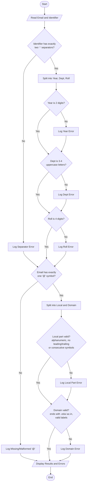

### Problem Statement

Design and implement a validation system for student institutional email addresses and registration identifiers based on strict formatting rules. The program must analyze an input email and identifier, and report specific structural defects—including malformed separators, invalid character groups, length violations, and missing components—or confirm validity.

#### Formatting Specifications

1. **Student Registration Identifier:**
* Format: `YY-DEPT-NNNN` (e.g., `23-CSE-1042`)
* `YY`: Exactly two digits representing the admission year (e.g., `20` to `29`).
* First Separator: Exactly one hyphen (`-`).
* `DEPT`: Exactly 3 or 4 uppercase alphabetic characters representing the department code (e.g., `CSE`, `ECE`, `MECH`).
* Second Separator: Exactly one hyphen (`-`).
* `NNNN`: Exactly four digits representing the unique roll number (e.g., `0001` to `9999`).


2. **Student Institutional Email Address:**
* Format: `local_part@domain`
* Separator: Exactly one `@` symbol separating `local_part` and `domain`.
* `local_part`: Alphanumeric characters separated by optional single periods (`.`), hyphens (`-`), or underscores (`_`). It cannot start or end with a symbol, and consecutive symbols are disallowed.
* `domain`: Must follow the educational sub-domain hierarchy `dept.college.edu` or `college.edu`. Domain labels must be lowercase alphabetic strings separated by single dots (`.`), with a top-level domain ending strictly in `.edu` or `.ac.in`.


---

### Algorithm

1. **Identifier Validation (`validate_id`):**
* Check if the identifier contains exactly two hyphen (`-`) delimiters. If not, record a malformed or missing separator error.
* Split the identifier into `year`, `dept`, and `roll`.
* Verify `year` contains exactly 2 numeric digits. If not, record an invalid character group or length error.
* Verify `dept` contains between 3 and 4 uppercase letters. If not, record an invalid department code error.
* Verify `roll` contains exactly 4 numeric digits. If not, record an invalid roll number error.
* Return all recorded errors or mark as valid.


2. **Email Validation (`validate_email`):**
* Check for the presence of the `@` delimiter. If missing or present more than once, record a delimiter defect.
* Split into `local_part` and `domain`.
* Validate `local_part`:
* Ensure it is non-empty and does not start or end with `.`, `_`, or `-`.
* Check for consecutive special symbols (e.g., `..`, `__`, `--`).
* Ensure all characters belong to the allowed set: `[a-zA-Z0-9._-]`.


* Validate `domain`:
* Ensure the domain ends with an accepted institutional suffix (`.edu` or `.ac.in`).
* Split the domain by `.` and ensure each label is non-empty, contains only lowercase alphabetic characters, and has no consecutive dots.


* Return all recorded errors or mark as valid.


3. **Execution:**
* Read the input email and registration identifier.
* Run both validation routines and print the status along with any detected structural defects.


---

### Flowchart



---

### Python Source Code

```python
import re

def validate_identifier(reg_id):
    errors = []
    if not reg_id:
        return ["Identifier is empty"]
    
    parts = reg_id.split("-")
    if len(parts) != 3:
        errors.append("Malformed separators: expected exactly two hyphens ('-')")
        return errors

    year, dept, roll = parts

    if not (len(year) == 2 and year.isdigit()):
        errors.append("Invalid year component: must be exactly 2 digits")

    if not (3 <= len(dept) <= 4 and dept.isalpha() and dept.isupper()):
        errors.append("Invalid department component: must be 3-4 uppercase letters")

    if not (len(roll) == 4 and roll.isdigit()):
        errors.append("Invalid roll number component: must be exactly 4 digits")

    return errors

def validate_email(email):
    errors = []
    if not email:
        return ["Email is empty"]

    if email.count("@") != 1:
        errors.append("Malformed separator: must contain exactly one '@' symbol")
        return errors

    local_part, domain = email.split("@")

    if not local_part:
        errors.append("Missing local part")
    else:
        if local_part[0] in "._-" or local_part[-1] in "._-":
            errors.append("Invalid local part: cannot start or end with a separator")
        if re.search(r"[._-]{2,}", local_part):
            errors.append("Invalid local part: contains consecutive separators")
        if not re.fullmatch(r"[a-zA-Z0-9._-]+", local_part):
            errors.append("Invalid character group in local part: allowed characters are alphanumeric, '.', '_', '-'")

    if not domain:
        errors.append("Missing domain part")
    else:
        valid_tlds = (".edu", ".ac.in")
        if not any(domain.endswith(tld) for tld in valid_tlds):
            errors.append("Invalid domain suffix: must terminate in '.edu' or '.ac.in'")
        
        domain_labels = domain.split(".")
        if any(len(label) == 0 for label in domain_labels):
            errors.append("Malformed domain: contains empty labels or consecutive dots")
        else:
            for label in domain_labels:
                if not (label.isalpha() and label.islower()):
                    errors.append(f"Invalid domain label '{label}': must contain only lowercase letters")
                    break

    return errors

def main():
    test_id = input().strip()
    test_email = input().strip()

    id_errors = validate_identifier(test_id)
    email_errors = validate_email(test_email)

    print("--- Identifier Validation ---")
    if not id_errors:
        print("Status: VALID")
    else:
        print("Status: INVALID")
        for err in id_errors:
            print(f"- {err}")

    print("\n--- Email Validation ---")
    if not email_errors:
        print("Status: VALID")
    else:
        print("Status: INVALID")
        for err in email_errors:
            print(f"- {err}")

if __name__ == "__main__":
    main()

```

---

### Sample Input 1

```text
24-CSE-0145
alex.turner@cs.university.edu

```

### Sample Output 1

```text
--- Identifier Validation ---
Status: VALID

--- Email Validation ---
Status: VALID

```

---

### Sample Input 2

```text
2024/cse-145
.alex..turner@univ_domain.com

```

### Sample Output 2

```text
--- Identifier Validation ---
Status: INVALID
- Malformed separators: expected exactly two hyphens ('-')

--- Email Validation ---
Status: INVALID
- Invalid local part: cannot start or end with a separator
- Invalid local part: contains consecutive separators
- Invalid domain suffix: must terminate in '.edu' or '.ac.in'
- Invalid domain label 'univ_domain': must contain only lowercase letters

```### Problem Statement

Design and implement a validation system for student institutional email addresses and registration identifiers based on strict formatting rules. The program must analyze an input email and identifier, and report specific structural defects—including malformed separators, invalid character groups, length violations, and missing components—or confirm validity.

#### Formatting Specifications

1. **Student Registration Identifier:**
* Format: `YY-DEPT-NNNN` (e.g., `23-CSE-1042`)
* `YY`: Exactly two digits representing the admission year (e.g., `20` to `29`).
* First Separator: Exactly one hyphen (`-`).
* `DEPT`: Exactly 3 or 4 uppercase alphabetic characters representing the department code (e.g., `CSE`, `ECE`, `MECH`).
* Second Separator: Exactly one hyphen (`-`).
* `NNNN`: Exactly four digits representing the unique roll number (e.g., `0001` to `9999`).


2. **Student Institutional Email Address:**
* Format: `local_part@domain`
* Separator: Exactly one `@` symbol separating `local_part` and `domain`.
* `local_part`: Alphanumeric characters separated by optional single periods (`.`), hyphens (`-`), or underscores (`_`). It cannot start or end with a symbol, and consecutive symbols are disallowed.
* `domain`: Must follow the educational sub-domain hierarchy `dept.college.edu` or `college.edu`. Domain labels must be lowercase alphabetic strings separated by single dots (`.`), with a top-level domain ending strictly in `.edu` or `.ac.in`.


---

### Algorithm

1. **Identifier Validation (`validate_id`):**
* Check if the identifier contains exactly two hyphen (`-`) delimiters. If not, record a malformed or missing separator error.
* Split the identifier into `year`, `dept`, and `roll`.
* Verify `year` contains exactly 2 numeric digits. If not, record an invalid character group or length error.
* Verify `dept` contains between 3 and 4 uppercase letters. If not, record an invalid department code error.
* Verify `roll` contains exactly 4 numeric digits. If not, record an invalid roll number error.
* Return all recorded errors or mark as valid.


2. **Email Validation (`validate_email`):**
* Check for the presence of the `@` delimiter. If missing or present more than once, record a delimiter defect.
* Split into `local_part` and `domain`.
* Validate `local_part`:
* Ensure it is non-empty and does not start or end with `.`, `_`, or `-`.
* Check for consecutive special symbols (e.g., `..`, `__`, `--`).
* Ensure all characters belong to the allowed set: `[a-zA-Z0-9._-]`.


* Validate `domain`:
* Ensure the domain ends with an accepted institutional suffix (`.edu` or `.ac.in`).
* Split the domain by `.` and ensure each label is non-empty, contains only lowercase alphabetic characters, and has no consecutive dots.


* Return all recorded errors or mark as valid.


3. **Execution:**
* Read the input email and registration identifier.
* Run both validation routines and print the status along with any detected structural defects.


---

### Flowchart


---

### Python Source Code

```python
import re

def validate_identifier(reg_id):
    errors = []
    if not reg_id:
        return ["Identifier is empty"]
    
    parts = reg_id.split("-")
    if len(parts) != 3:
        errors.append("Malformed separators: expected exactly two hyphens ('-')")
        return errors

    year, dept, roll = parts

    if not (len(year) == 2 and year.isdigit()):
        errors.append("Invalid year component: must be exactly 2 digits")

    if not (3 <= len(dept) <= 4 and dept.isalpha() and dept.isupper()):
        errors.append("Invalid department component: must be 3-4 uppercase letters")

    if not (len(roll) == 4 and roll.isdigit()):
        errors.append("Invalid roll number component: must be exactly 4 digits")

    return errors

def validate_email(email):
    errors = []
    if not email:
        return ["Email is empty"]

    if email.count("@") != 1:
        errors.append("Malformed separator: must contain exactly one '@' symbol")
        return errors

    local_part, domain = email.split("@")

    if not local_part:
        errors.append("Missing local part")
    else:
        if local_part[0] in "._-" or local_part[-1] in "._-":
            errors.append("Invalid local part: cannot start or end with a separator")
        if re.search(r"[._-]{2,}", local_part):
            errors.append("Invalid local part: contains consecutive separators")
        if not re.fullmatch(r"[a-zA-Z0-9._-]+", local_part):
            errors.append("Invalid character group in local part: allowed characters are alphanumeric, '.', '_', '-'")

    if not domain:
        errors.append("Missing domain part")
    else:
        valid_tlds = (".edu", ".ac.in")
        if not any(domain.endswith(tld) for tld in valid_tlds):
            errors.append("Invalid domain suffix: must terminate in '.edu' or '.ac.in'")
        
        domain_labels = domain.split(".")
        if any(len(label) == 0 for label in domain_labels):
            errors.append("Malformed domain: contains empty labels or consecutive dots")
        else:
            for label in domain_labels:
                if not (label.isalpha() and label.islower()):
                    errors.append(f"Invalid domain label '{label}': must contain only lowercase letters")
                    break

    return errors

def main():
    test_id = input().strip()
    test_email = input().strip()

    id_errors = validate_identifier(test_id)
    email_errors = validate_email(test_email)

    print("--- Identifier Validation ---")
    if not id_errors:
        print("Status: VALID")
    else:
        print("Status: INVALID")
        for err in id_errors:
            print(f"- {err}")

    print("\n--- Email Validation ---")
    if not email_errors:
        print("Status: VALID")
    else:
        print("Status: INVALID")
        for err in email_errors:
            print(f"- {err}")

if __name__ == "__main__":
    main()

```

---

### Sample Input 1

```text
24-CSE-0145
alex.turner@cs.university.edu

```

### Sample Output 1

```text
--- Identifier Validation ---
Status: VALID

--- Email Validation ---
Status: VALID

```

---

### Sample Input 2

```text
2024/cse-145
.alex..turner@univ_domain.com

```

### Sample Output 2

```text
--- Identifier Validation ---
Status: INVALID
- Malformed separators: expected exactly two hyphens ('-')

--- Email Validation ---
Status: INVALID
- Invalid local part: cannot start or end with a separator
- Invalid local part: contains consecutive separators
- Invalid domain suffix: must terminate in '.edu' or '.ac.in'
- Invalid domain label 'univ_domain': must contain only lowercase letters

```
