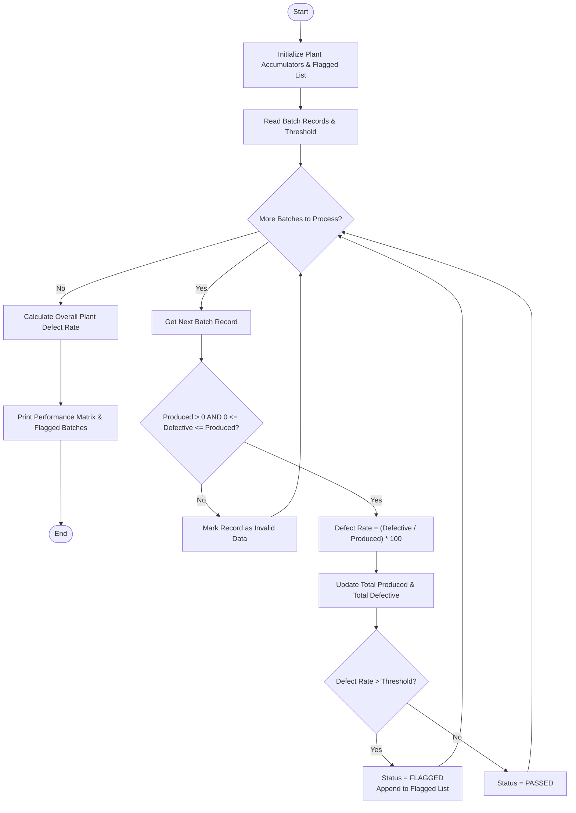

### Problem Statement

In a manufacturing plant, multiple product lines produce goods across distinct production batches. To uphold standard operating quality, quality assurance teams track the total units produced and the total defective units detected for every batch.

Given a dataset containing batch records—where each record specifies the Product Name, Batch ID, Total Units Produced, Defective Units Count, and an Acceptable Defect Threshold Percentage—implement a system to:

1. Validate production metrics (ensuring non-negative values and non-zero production).
2. Calculate the defect rate percentage for each batch:

$$\text{Defect Rate (\%)} = \left(\frac{\text{Defective Units}}{\text{Total Units Produced}}\right) \times 100$$


3. Flag batches where the defect rate strictly exceeds the allowed tolerance threshold.
4. Output a comprehensive audit report detailing batch performance, overall quality status, and an alert list for flagged batches requiring quarantine or review.

---

### Algorithm

1. **Initialize Data Structures:**
* Define a collection of batch records, where each record contains: Product ID/Name, Batch ID, Produced Units, Defective Units, and Max Allowed Defect Threshold (%).
* Initialize summary counters/lists: Total Production, Total Defective Units, and Flagged Batches List.


2. **Iterate Through Each Batch Record:**
* Check if $\text{Produced Units} \le 0$:
* If true, mark record as invalid and skip calculation.


* Check if $\text{Defective Units} > \text{Produced Units}$ or $\text{Defective Units} < 0$:
* If true, mark record as inconsistent and skip calculation.


* Compute $\text{Defect Percentage} = (\text{Defective Units} / \text{Produced Units}) \times 100$.
* Compare $\text{Defect Percentage}$ with $\text{Threshold}$:
* If $\text{Defect Percentage} > \text{Threshold}$, set batch status to `"FLAGGED / NON-COMPLIANT"` and append to Flagged Batches List.
* Else, set batch status to `"PASSED / COMPLIANT"`.


* Update aggregate metrics:
* $\text{Total Production} \leftarrow \text{Total Production} + \text{Produced Units}$
* $\text{Total Defective Units} \leftarrow \text{Total Defective Units} + \text{Defective Units}$


3. **Compute Global Metrics:**
* Compute $\text{Overall Plant Defect Rate} = (\text{Total Defective Units} / \text{Total Production}) \times 100$.


4. **Display Report:**
* Print individual batch metrics, defect rates, thresholds, and operational status.
* Print aggregate plant metrics.
* List all flagged batches requiring immediate quality interventions.


---

### Flowchart



---

### Python Source Code

```python
from dataclasses import dataclass

@dataclass
class BatchRecord:
    product_name: str
    batch_id: str
    produced: int
    defective: int
    threshold_pct: float

def analyze_quality_matrix(batches):
    total_produced = 0
    total_defective = 0
    flagged_batches = []
    matrix_results = []

    for b in batches:
        if b.produced <= 0 or b.defective < 0 or b.defective > b.produced:
            matrix_results.append({
                "product": b.product_name,
                "batch_id": b.batch_id,
                "produced": b.produced,
                "defective": b.defective,
                "defect_pct": None,
                "threshold_pct": b.threshold_pct,
                "status": "INVALID_DATA"
            })
            continue

        defect_pct = (b.defective / b.produced) * 100
        is_flagged = defect_pct > b.threshold_pct

        total_produced += b.produced
        total_defective += b.defective

        status = "FLAGGED" if is_flagged else "PASSED"
        
        result_entry = {
            "product": b.product_name,
            "batch_id": b.batch_id,
            "produced": b.produced,
            "defective": b.defective,
            "defect_pct": defect_pct,
            "threshold_pct": b.threshold_pct,
            "status": status
        }
        matrix_results.append(result_entry)

        if is_flagged:
            flagged_batches.append(result_entry)

    overall_defect_pct = (total_defective / total_produced * 100) if total_produced > 0 else 0.0

    print(f"{'PRODUCT':<16} {'BATCH ID':<10} {'PRODUCED':<10} {'DEFECTIVE':<10} {'DEFECT %':<10} {'LIMIT %':<10} {'STATUS':<10}")
    print("-" * 78)
    for r in matrix_results:
        defect_str = f"{r['defect_pct']:.2f}%" if r['defect_pct'] is not None else "N/A"
        print(f"{r['product']:<16} {r['batch_id']:<10} {r['produced']:<10} {r['defective']:<10} {defect_str:<10} {r['threshold_pct']:<10.2f} {r['status']:<10}")

    print("-" * 78)
    print(f"Total Produced Units: {total_produced}")
    print(f"Total Defective Units: {total_defective}")
    print(f"Plant Overall Defect Rate: {overall_defect_pct:.2f}%")
    print(f"Flagged Batches Count: {len(flagged_batches)}")
    
    if flagged_batches:
        print("\nACTION REQUIRED - Batches Exceeding Tolerance:")
        for fb in flagged_batches:
            excess = fb['defect_pct'] - fb['threshold_pct']
            print(f"- [{fb['batch_id']}] {fb['product']}: Defect Rate {fb['defect_pct']:.2f}% exceeds limit of {fb['threshold_pct']:.2f}% by +{excess:.2f}%")

if __name__ == "__main__":
    records = [
        BatchRecord("Piston Ring", "B101", 5000, 120, 2.0),
        BatchRecord("Piston Ring", "B102", 4800, 160, 2.0),
        BatchRecord("Spark Plug", "B201", 12000, 180, 1.2),
        BatchRecord("Spark Plug", "B202", 11500, 210, 1.2),
        BatchRecord("Brake Rotor", "B301", 2500, 95, 3.0),
        BatchRecord("Brake Rotor", "B302", 3000, 60, 3.0)
    ]
    analyze_quality_matrix(records)

```

---

### Sample Input

```python
[
    BatchRecord(product_name="Piston Ring", batch_id="B101", produced=5000, defective=120, threshold_pct=2.0),
    BatchRecord(product_name="Piston Ring", batch_id="B102", produced=4800, defective=160, threshold_pct=2.0),
    BatchRecord(product_name="Spark Plug", batch_id="B201", produced=12000, defective=180, threshold_pct=1.2),
    BatchRecord(product_name="Spark Plug", batch_id="B202", produced=11500, defective=210, threshold_pct=1.2),
    BatchRecord(product_name="Brake Rotor", batch_id="B301", produced=2500, defective=95, threshold_pct=3.0),
    BatchRecord(product_name="Brake Rotor", batch_id="B302", produced=3000, defective=60, threshold_pct=3.0)
]

```

---

### Sample Output

```text
PRODUCT          BATCH ID   PRODUCED   DEFECTIVE  DEFECT %   LIMIT %    STATUS    
------------------------------------------------------------------------------
Piston Ring      B101       5000       120        2.40%      2.00       FLAGGED   
Piston Ring      B102       4800       160        3.33%      2.00       FLAGGED   
Spark Plug       B201       12000      180        1.50%      1.20       FLAGGED   
Spark Plug       B202       11500      210        1.83%      1.20       FLAGGED   
Brake Rotor      B301       2500       95         3.80%      3.00       FLAGGED   
Brake Rotor      B302       3000       60         2.00%      3.00       PASSED    
------------------------------------------------------------------------------
Total Produced Units: 38800
Total Defective Units: 825
Plant Overall Defect Rate: 2.13%
Flagged Batches Count: 5

ACTION REQUIRED - Batches Exceeding Tolerance:
- [B101] Piston Ring: Defect Rate 2.40% exceeds limit of 2.00% by +0.40%
- [B102] Piston Ring: Defect Rate 3.33% exceeds limit of 2.00% by +1.33%
- [B201] Spark Plug: Defect Rate 1.50% exceeds limit of 1.20% by +0.30%
- [B202] Spark Plug: Defect Rate 1.83% exceeds limit of 1.20% by +0.63%
- [B301] Brake Rotor: Defect Rate 3.80% exceeds limit of 3.00% by +0.80%

```
